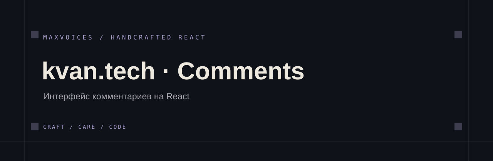
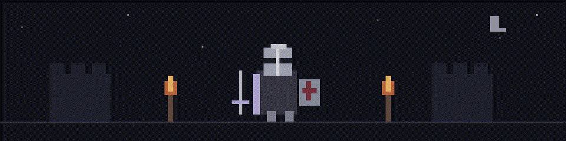
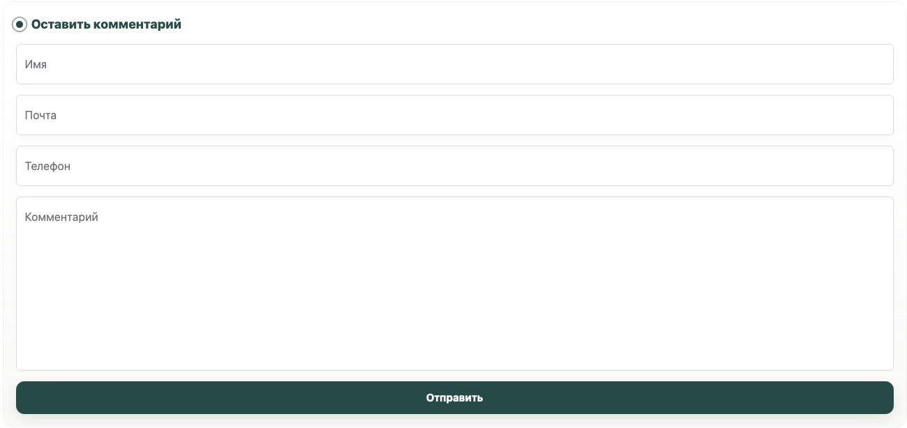

<p align="center"></p>
<p align="center"></p>
<p align="center"><sub>Из мастерской Максима Голосова · MaxVoices</sub></p>

# kvan.tech · Comments

Фронтенд комментариев для сайта компании **kvan.tech**. Интерфейс, дизайн и React-код созданы Максимом Голосовым **вручную, без ИИ**. Компонент показывает работу с состоянием, формами, валидацией и ответами на комментарии.

| Контекст | Детали |
| :--- | :--- |
| Заказчик | kvan.tech |
| Моя роль | Дизайн интерфейса и фронтенд-разработка |
| Авторство кода | Написан вручную, без ИИ |
| Технологии | React 19, Vite 7, JavaScript, CSS / LESS, Bootstrap 5 |

[Каркасная модель в Figma ↗](https://www.figma.com/design/kgnISAK7smnd6XXyIiUYFJ/Untitled?node-id=0-1)

Figma показывает структуру интерфейса. Это каркасная модель, она не воспроизводит окончательный дизайн продакшена.

## Интерфейс



## Возможности

- Список комментариев с аватарами, именами и временем.
- Форма нового комментария с проверкой имени, email, телефона и текста.
- Ответы на комментарии и отдельная форма ответа.
- Обновление интерфейса через React state.
- Компоненты для формы, полей, комментария и вложенных ответов.

## Запустить локально

Нужен Node.js **22.12+** или более новый совместимый LTS и npm.

```bash
npm ci
npm run dev -- --host 127.0.0.1
```

Откройте адрес, который Vite напечатает в терминале, обычно **http://127.0.0.1:5173**.

```bash
npm run build       # собрать production-версию в dist/
npm run preview     # проверить готовую сборку
npm run lint        # проверить код ESLint
```

## Как устроено

```text
src/
  App.jsx                          Состояние комментариев и ответов
  components/
    Form/                          Форма добавления комментария
    Comments/
      data.js                      Демонстрационные комментарии
      Comment/                     Комментарий, ответы и форма ответа
  utils/validation.js              Проверка полей
```

В этой версии данные хранятся в памяти браузера и сбрасываются после перезагрузки. Сервер, БД, авторизация и модерация в репозиторий не входят. Демо-форма не отправляет введённые контакты на сервер.

## Деплой на Vercel

Импортируйте репозиторий, выберите **Vite**, команда сборки `npm run build`, выходная папка `dist`. Переменные окружения для этого фронтенда не нужны. Ссылку на проверенное демо добавим после развёртывания.


## Автор

**Максим Голосов / MaxVoices** · [GitHub](https://github.com/MaxVoicesDeveloper) · [Связаться](https://t.me/MaxVoicesDeveloper)

<sub>Клиентские названия, логотипы, фотографии и другие материалы принадлежат соответствующим правообладателям. Публикация в портфолио не предоставляет право использовать их в других коммерческих проектах.</sub>
